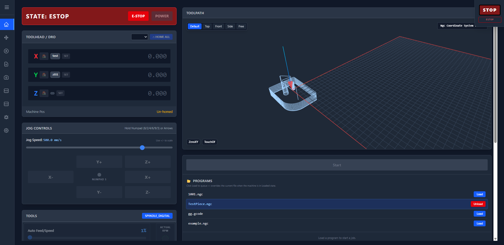

# What it does

LinuxCNC Web UI turns a small computer next to your machine into its control panel — one you
open in a browser, on a tablet, a laptop or a phone.

- **Run your machine** — power, emergency stop, homing, jogging, positions at a glance.
- **Print and cut** — send jobs straight from your slicer, preview them, start, pause and stop.
- **3D printing built in** — heaters, fans, the extruder, bed levelling and probe calibration.
- **Configure it like Klipper** — describe your printer in one familiar config file; the UI
  sets up everything else.
- **Watch it** — temperatures, a live camera, a log of everything the machine does.
- **Arrange it your way** — choose which panels each page shows and where.
- **Works offline** — everything runs on your machine; no cloud, no account.

Ready? Continue with {doc}`installation`.
