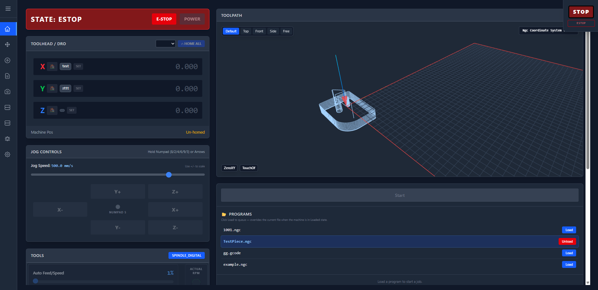

# LinuxCNC Web UI

The manual for the LinuxCNC Web UI: control a 3D printer or CNC machine from the browser, with
a LinuxCNC host (BTT CB1, Raspberry Pi) and [Remora](https://github.com/q4yz/Remora-m8p)
boards (BTT Manta M8P, Octopus, …), configured like Klipper.



New here? Read **Getting Started** from top to bottom: it goes from an empty SD card to a
moving machine. Pick the version matching your installation in the version menu; *Edit on
GitHub* opens the page's source.

```{toctree}
:maxdepth: 2
:caption: Getting Started

getting-started/what-it-does
getting-started/installation
getting-started/install-from-repo
getting-started/toolhead-board
getting-started/wiring
getting-started/config
getting-started/config-reference
getting-started/config-examples
getting-started/compile
```

```{toctree}
:maxdepth: 2
:caption: Using the UI

using/dashboard
using/jogging
using/console-commands
using/probing-levelling
using/programs
using/hal-tools
```

```{toctree}
:maxdepth: 2
:caption: Architecture

architecture/architecture
architecture/remora-components
architecture/writing-docs
```

```{toctree}
:maxdepth: 2
:caption: Help

reference/troubleshooting
```
